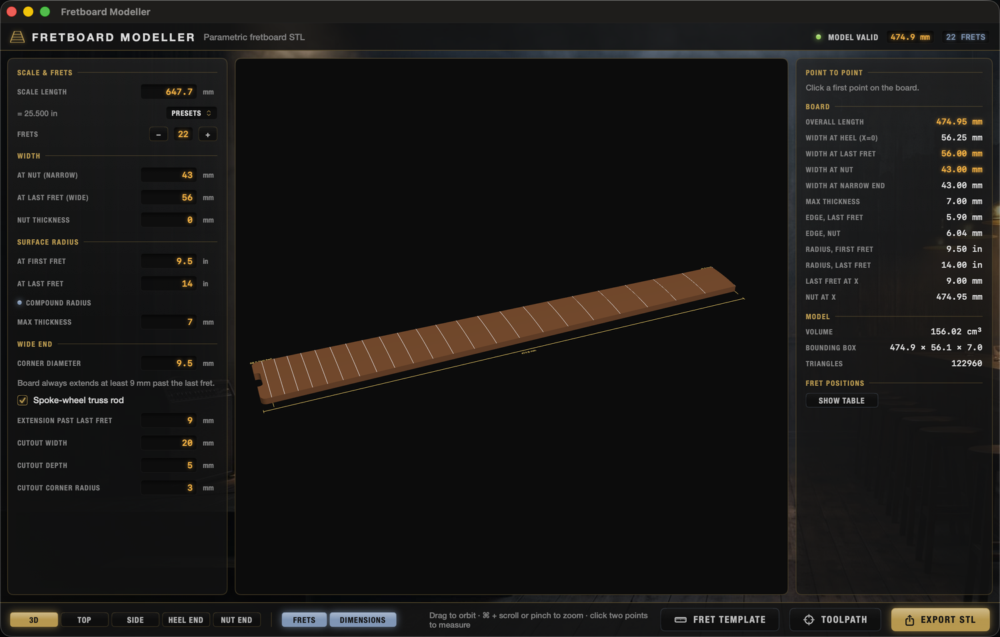
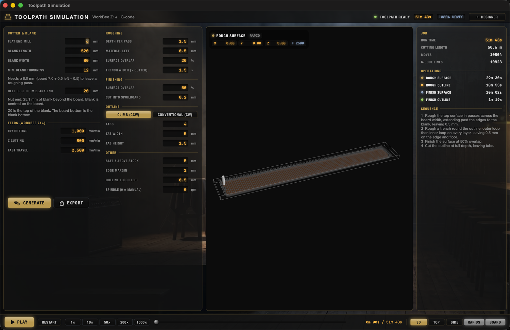
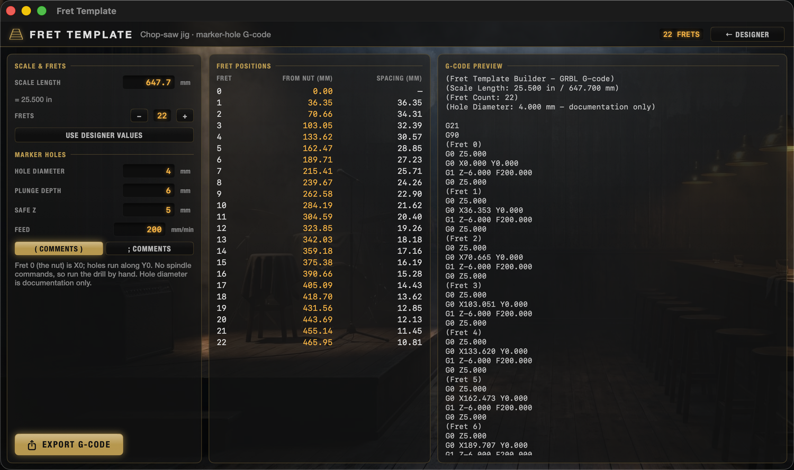

# Fretboard Modeller

A native macOS app (SwiftUI + SceneKit) for making guitar fretboards. It has four tools, each a tab in one window (⌘1 to ⌘4):

1. **Designer** – builds a dimensionally accurate fretboard solid, lets you inspect and measure it, and exports a binary STL (millimetres).
2. **Markers** – plans fret dots and a custom 12th-fret inlay traced from an image, cuts them into the model and STL, and writes their own G-code files.
3. **Toolpath** – generates WorkBee Z1+ (Duet / RepRapFirmware) G-code to machine the board from a blank, with animated playback.
4. **Fret Template** – generates marker-hole G-code for the jig used to cut fret slots on a chop saw.

A full illustrated walk-through is in [`docs/Fretboard-Modeller-User-Guide.pdf`](docs/Fretboard-Modeller-User-Guide.pdf).



## Designer
- Inputs: scale length (mm, with inch presets), fret count, nut width, last-fret width, nut thickness (default 0), surface radius at the first and last fret in inches (equal = constant radius, different = compound), max thickness (7 mm), wide-end corner diameter (9.5 mm).
- The widest end is at the origin (X = 0, the heel); the narrowest end is toward +X. The wide corners are rounded; the narrow end has hard corners.
- The board always extends at least 9 mm past the last fret (configurable, default 9 mm).
- **Spoke-wheel truss rod** (on by default): adds a cutout centred on the heel edge, default 20 mm wide × 5 mm deep with 3 mm inside corner radius, all editable.
- Compound radius is modelled as a cone-like surface: the centre-line stays at the max thickness, so the edges get thinner toward the wider end. Edge thicknesses are shown in the measurements panel.
- Viewer: orbit, ⌘ + scroll or pinch to zoom, preset views, fret lines, dimension lines, click two points to measure.
- Export: binary STL; the mesh is checked to be watertight.

## Markers
- **Modes:** none, dots, dots + 12th-fret inlay (the inlay replaces the 12th double dot), or the inlay only.
- **Dots:** 6 mm × 3 mm by default, in the middle of the chosen fret spaces (3, 5, 7, 9, 12, 15, 17, 19, 21, 24), with a flat floor 3 mm below the surface at the dot centre. The 12th (and 24th) are double dots under the **B and A strings**. String positions run straight from the nut (outer E strings 3 mm in from the edges) to a Les Paul tune-o-matic (52.4 mm E to E) with **compensated spacing** (equal gaps between the strings' edges, from the gauges). Because the bass strings are heavier, the pair sits slightly toward the treble side (0.75 mm with .010–.046).
- **Orientation:** the board is right-handed by default, with the bass side at +Y. The Markers plan shows it the same way round as the Designer's top view (heel on the left, nut on the right, bass side at the top), and the inlay reads upright in that view. Tick *Left-handed board* to mirror the string layout; the plan and the inlay then turn half a turn.
- **Inlay:** choosing a mode with a 12th-fret inlay starts from the bundled default design (`Assets/default-inlay.png`), 45 mm tall across the board. To use your own, import a black-and-white image (PNG, JPEG, PDF, …), paste one, drag one in, or **Capture** an area of the screen from a design app. Black becomes the pocket; holes and islands are kept. Threshold, invert and smoothing adjust the trace. Size it freely or with the aspect ratio locked, move it, rotate it or mirror it. It is centred on the 12th fret space and may span the 11th to 13th; the app warns which fret slots will cross it. The pocket floor follows the board radius, 3 mm deep everywhere.
- The pockets are cut into the Designer model and the STL (the mesh stays watertight).
- **G-code** (two separate files):
  - *Dots* – the 6 mm cutter, peck-drilled (or spiralled out if a dot is wider than the cutter), using the board job's origin (X0 heel edge, Y0 centre line, Z0 top of the blank, blank thickness from the Toolpath tab). Run it after surfacing, while the board is still held by its tabs.
  - *Inlay* – a separate fine cutter (default 0.9 mm, 9 mm flutes). Zero on the board origin or on the **centre of the inlay** (Z0 = board surface there). Offset loops cut inside out on 0.3 mm layers; every entry ramps in along the path at 2°, the first loop after each entry runs at a reduced slot feed, and each layer ends with a light 0.05 mm finishing pass on the walls. Parts of the design narrower than the cutter are reported and shown in red.
- **3D playback:** after GENERATE, switch the preview from PLAN to **3D DOTS** or **3D INLAY** to play either job on the board with a moving cutter and live X/Y/Z/feed readout (same controls as the Toolpath tab). 3D Inlay frames the 12th fret; readouts are in the job's own coordinates, so they match the file even with the inlay-centre zero.
- Air-cut first with Z raised, then try scrap hardwood.

## Projects
- **File › New Project (⌘N), Open… (⌘O), Save (⌘S), Save As… (⇧⌘S).** A project is a `.fretboard` file (JSON) holding the board dimensions, the CNC settings, the markers, both marker jobs' settings, the trace options and the inlay image itself, so it opens on another Mac without the original image.
- The project name is shown in the header and window title; an amber dot and “Edited” mean there are unsaved changes. New, Open and Quit ask before discarding them.
- Generated toolpaths aren't saved; press GENERATE again after opening. Files from older versions open with defaults for anything they lack; files from a newer version are refused.

## Toolpath (CNC)
The **Toolpath** tab (⌘3) generates G-code and plays the run back at 1× to 1000× with a moving cutter and live X/Y/Z/feed readout.

- **Machine:** Ooznest WorkBee Z1+, Duet / RepRapFirmware dialect. Work origin: X0 = heel edge of the board, Y0 = board centre line, Z0 = top of the blank. Cutter: 6 mm flat end mill.
- **Feeds:** X/Y cutting 1000 mm/min, Z cutting 800 mm/min, fast travel configurable (default 2500 mm/min is a placeholder – set it to your machine's maximum).
- **Blank:** set the blank length, width, thickness and where the board sits in it before generating. The blank thickness is a *minimum*: it must be at least board thickness + material left + 0.5 mm so there is always a roughing pass. The path is clipped to the blank and checked against it.
- **Sequence** (all aimed at reducing splitting):
  1. Rough the top surface – passes across the board width, extending past the edges, 1.5 mm deep, leaving 0.5 mm, 20 % overlap.
  2. Rough a trench round the outline – 1.5× the cutter width, two loops on every depth layer, outer loop first and the loop beside the board last, leaving 0.5 mm.
  3. Finish the surface – 50 % overlap.
  4. Cut the outline at full depth, leaving tabs.
- **Tabs:** default 4 tabs, 5 mm wide, 1.5 mm tall, hold the board in the blank on the final cut; cut them away by hand.
- **Outline direction:** climb (counter-clockwise) or conventional (clockwise) – flip it if you see splitting on one side.
- The cutter never cuts below the surface (checked by the tests). The playback shows the path, not material removal.



## Fret Template
Ported from the standalone Fret Template Builder. Computes fret positions from the nut (`d = L·(1 − 1/2^(n/12))`) and writes GRBL-style G-code that drills marker holes on the centre line (Y0) at each fret (fret 0 = X0). Defaults: 4 mm hole (documentation only), 6 mm plunge, 5 mm safe Z, 200 mm/min. No spindle commands – run the drill by hand. Scale length and fret count start from the designer's values.



## Build and run
```sh
swift run FretboardApp          # run from the command line
./make_app.sh                   # build "Fretboard Modeller.app" into ~/Applications (Spotlight-launchable)
```
Requires macOS 13+ and a Swift 5.9+ toolchain (Command Line Tools are enough).

## Tests
```sh
swift test
```
With only the Command Line Tools installed (no Xcode), the swift-testing framework needs extra paths:
```sh
F=/Library/Developer/CommandLineTools/Library/Developer/Frameworks
U=/Library/Developer/CommandLineTools/Library/Developer/usr/lib
DYLD_LIBRARY_PATH=$U swift test -Xswiftc -F$F -Xlinker -F$F -Xlinker -rpath -Xlinker $F -Xlinker -rpath -Xlinker $U
```

## Layout
- `Sources/FretboardKit` – geometry, mesh, STL, measurements, toolpath and G-code generation, fret template (no UI)
- `Sources/FretboardApp` – SwiftUI app, SceneKit viewers, the four tools, each a tab in the single window (`AppShell.swift` lists them)
- `Tests/FretboardKitTests` – geometry, mesh, toolpath and template tests
- `docs/` – user guide (PDF + HTML source) and screenshots
- `tools/make_icon.swift` – renders the app icon (`Resources/AppIcon.icns`)

## License
Released under the [MIT License](LICENSE). The software is provided as-is, with no warranty: always check generated G-code against your own machine and dry-run above the stock before cutting.
